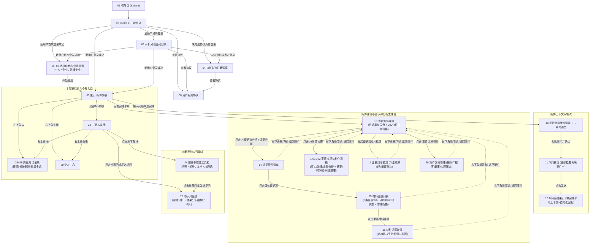

# 律法AI（AI 英诺律法）产品需求文档 (PRD) & 前后端技术选型方案

> **文档版本**：v1.3（新建案件后端纳入一期）
> **评审日期**：2026-11-12  
> **更新日期**：2026-11-14
> **基于原型**：[ui-screens/index.html](file:///Users/xiaoqi/dev/law/ui-screens/index.html)（共 9 个画布、29 张状态页截图，其中第 18 页标注为废弃）  
> **目标端**：微信小程序端（核心首发）+ 移动端 H5 / App 跨端演进  

---

## 一、 产品概述与核心定位

### 1.1 产品背景与定位
**律法AI（AI 英诺律法）** 是一款以 AI 法律智能体「小诺」为核心交互载体的 **案件材料管理与法律咨询辅助工具**。当前原型覆盖案件列表与详情、材料证据查看、AI 辅助案情梳理、证据清单整理、文档归档及上下文问答；原型未展示完整建案、案件编辑、证据新增/上传及审核工作流，因此不将其描述为已闭合的案件全生命周期产品。胜诉率展示仅是原型中的结果指标，计算口径、适用范围及其法律表达必须在上线前另行确认。

### 1.2 目标用户群与角色画像
产品在首次注册登录时明确区分三类目标角色（对应原型 `05` ~ `07`）：
1. **个人用户**：遭遇民事纠纷（如房屋买卖、拆迁补偿、民间借贷等）的当事人，需要了解案件材料、获取证据收集指引及通俗易懂的法律建议；原型展示的“胜诉率”是否作为用户决策指标尚待确认。
2. **企业用户**：企业法务、管理层或合规人员，需要管理企业涉诉案件、归档合同与庭审文档、评估诉讼风险。
3. **法律专业用户**：执业律师、实习律师、法律顾问等，需要利用 AI 快速完成案情时间轴梳理、争议焦点归纳、证据链审查与法律文书起草。

---

## 二、 信息架构与页面流转全景

### 2.1 核心导航架构
原型打破了传统移动端底部 4-Tab 的常规布局，采用了 **“AI First” 的顶部双核导航 + 底部常驻多模态输入栏** 架构：
- **顶部导航栏**：
  - **左侧按钮 (`☰`)**：呼出「历史对话记录」管理页（支持搜索、按时间筛选、长按删除、批量多选、新建对话）。
  - **中部一级 Tab**：`案件`（面向结构化案件管理与上下文问答）与 `助手`（面向开放式法律咨询与文书生成）平级切换。
  - **右侧头像**：点击进入「个人中心」。
  - *注：进入小程序端时，顶部导航右侧需预留微信小程序原生胶囊按钮（Menu Button）安全距离，可将用户头像调整至左上角与侧边栏按钮并列，或放入顶部二级栏。*
- **底部常驻区**：在「案件」首页、「案件详情」页及「助手」页底部，均常驻 **多模态 AI 输入栏**（扩展附件 `⊕` + 文本输入 + 语音录入/发送按钮）。

### 2.2 全局页面流转图 (Mermaid)



---

## 三、 全量页面功能需求详述（29 页原型逐页映射）

### 模块一：启动与认证注册（对应 `01` ~ `08`）

| 原型编号与文件 | 页面名称 | 详细功能与交互需求 |
| :--- | :--- | :--- |
| **01** [`01-01引导页.png`](file:///Users/xiaoqi/dev/law/ui-screens/screens/01-01引导页.png) | 启动引导页 | - 展示 3D 机器人形象“小诺”及品牌标语「您最可靠的案件助手！ / 欢迎来到 AI 英诺律法」。<br>- **逻辑**：冷启动展示 1.5~2 秒（小程序端可作为未登录态落地欢迎页），校验本地 Token：有效则直达 `09 案件首页`，无效则跳转 `02 一键登录页`。 |
| **02** [`02-登录注册-01-登录8.png`](file:///Users/xiaoqi/dev/law/ui-screens/screens/02-登录注册-01-登录8.png) | 手机号授权登录 | - **视觉元素**：企业 Logo、脱敏手机号展示样式、运营商认证标识（按最终登录方案确认；小程序不能读取设备本机号码作为默认值）。<br>- **操作按钮**：主按钮可映射为微信手机号快速验证/授权，须由用户主动点击并处理拒绝授权；次按钮「其他手机号/账号登录」（跳转 `03`）。短信登录是否保留为首发能力待确认。<br>- **底部协议栏**：单选框（默认未勾选）+《用户服务》《隐私政策》《免责声明》（注：原型写为“免费声明”，正式名称待产品/法务确认）。 |
| **03** [`03-登录-02.png`](file:///Users/xiaoqi/dev/law/ui-screens/screens/03-登录-02.png) | 手机号验证码登录 | - **表单字段**：`+86` 手机号输入框（11位数字校验）、验证码输入框 +「发送验证码」按钮（点击后校验手机号格式与协议勾选，通过后触发 60s 倒计时重发）。<br>- **主按钮**：「登录」（未注册手机号验证通过后自动注册）。 |
| **04** [`04-登录-勾选协议提示.png`](file:///Users/xiaoqi/dev/law/ui-screens/screens/04-登录-勾选协议提示.png) | 协议未勾选拦截弹窗 | - **触发条件**：用户在 `02` 或 `03` 未勾选底部协议时点击登录。<br>- **弹窗交互**：居中模态框提示「请阅读勾选协议：已阅读用户服务、隐私政策和免责声明」。点击「同意」自动勾选底层协议并继续执行登录动作；点击「不同意」或右上角 `×` 仅关闭弹窗。 |
| **05** [`05-选择角色03-个人.png`](file:///Users/xiaoqi/dev/law/ui-screens/screens/05-选择角色03-个人.png)<br>**06** [`06-选择角色03-企业用户.png`](file:///Users/xiaoqi/dev/law/ui-screens/screens/06-选择角色03-企业用户.png)<br>**07** [`07-选择角色03-法律专业用户.png`](file:///Users/xiaoqi/dev/law/ui-screens/screens/07-选择角色03-法律专业用户.png) | 新用户角色选择页 | - **触发条件**：新注册用户首次完成手机号验证后进入。<br>- **角色切换胶囊 Tab**（三选一，切换时动态渲染下方表单）：<br>  1. **个人用户 (05)**：仅需填写 `姓名`（必填）。<br>  2. **企业用户 (06)**：需填写 `姓名`、`企业名称`、`担任职位`，下拉选择 `所在行业`。<br>  3. **法律专业用户 (07)**：需填写 `姓名`、`单位名称`（律所/机构），下拉选择 `角色`（如执业律师、实习律师、法务、学者等）。<br>- **提交**：点击底部「开始使用」保存资料并进入 `09 案件首页`。 |
| **08** [`08-服务协议-03.png`](file:///Users/xiaoqi/dev/law/ui-screens/screens/08-服务协议-03.png) | 用户服务协议页 | - 顶部左返回箭头 + 标题「用户服务」，正文展示更新日期、生效日期及协议条款富文本。 |

---

### 模块二：案件列表与基于案件上下文的 AI 问答（对应 `09` ~ `13`）

| 原型编号与文件 | 页面名称 | 详细功能与交互需求 |
| :--- | :--- | :--- |
| **09** [`09-案件01.png`](file:///Users/xiaoqi/dev/law/ui-screens/screens/09-案件01.png) | 案件列表首页 | - **AI 欢迎 Banner**：小诺 3D 形象 + 分时段问候语。<br>- **案件搜索栏**：支持按案件名称关键词模糊搜索。<br>- **案件卡片列表**：每张卡片展示：<br>  - 左上：案件名称（如“王家村房屋拆迁补偿纠纷案”）；<br>  - 左下：`证据上传` 状态（蓝色“已完成” / 红色“未上传”）、`案件程序`（如“一审”）；<br>  - 右上状态角标与右侧 **环形刻度仪表盘** 联动（共 3 种状态）：<br>    1. **已分析**（绿底角标）：仪表盘显示蓝色进度弧与具体百分比（如 `80% 胜诉率`）；<br>    2. **未分析**（粉红角标）：仪表盘中心显示 `? 胜诉率`；<br>    3. **分析中**（蓝紫角标）：仪表盘中心显示 `分析中 胜诉率`。<br>- **底部输入栏**：左侧 `⊕` 按钮，中间输入框「关于案件，有什么想要咨询的？」，未输入时右侧为**语音按钮**，输入文字后变为**发送纸飞机图标**。 |
| **10** [`10-案件02.png`](file:///Users/xiaoqi/dev/law/ui-screens/screens/10-案件02.png) | 提问勾选案件模式 | - **交互逻辑**：用户在 `09` 底部输入框输入问题（如“被告是否应承担侵权责任”）并点击发送时，因未指定关联案件，弹出居中提示框「请先选择对应案件进行问答」。<br>- **卡片勾选态**：点击「确定」关闭弹窗后，案件列表进入选择模式，每张案件卡片左上角出现圆形单选框 `○ / ✓`，用户勾选一个目标案件后跳转至 `11 AI问答页`。 |
| **11** [`11-案件03.png`](file:///Users/xiaoqi/dev/law/ui-screens/screens/11-案件03.png) | AI问答页（待发送态） | - **上下文卡片挂载**：底部输入框正下方挂载所选案件的浅灰摘要卡片（展示案件名称、证据上传、胜诉率、案件程序、证据分析 4 项指标），右上角带 `×` 按钮支持移除关联。<br>- 输入框右侧发送按钮变为亮蓝色激活态，点击正式发送提问。 |
| **12** [`12-案件04.png`](file:///Users/xiaoqi/dev/law/ui-screens/screens/12-案件04.png) | AI问答页（生成结果态） | - **用户消息气泡（右侧）**：上方为蓝底白字提问文本，下方紧跟所挂载的关联案件摘要卡片。<br>- **AI 回复卡片（左侧）**：白底圆角大卡片，支持 Markdown 结构化编号列表输出（如合同履行、行为性质、民法典侵权责任分析、结论建议）。<br>- **回复卡片底部工具栏**：左侧提供「一键复制」「导出/下载文档」按钮；右侧提供「点赞（高亮态）」「点踩」反馈按钮。 |
| **13** [`13-案件05-查看详情.png`](file:///Users/xiaoqi/dev/law/ui-screens/screens/13-案件05-查看详情.png) | 查看案件详情页 | - **触发入口**：在 `09` 点击某张案件卡片进入。<br>- **顶部核心看板**：展示案件名称、居中大号胜诉率环形刻度仪表盘（`80% 胜诉率` + 底部镶嵌绿色「已分析」胶囊标签）、证据上传与案件程序状态。<br>- **查看案件分析结果（2×2 宫格导航）**：<br>  1. `AI证据链分析`（一键查看证据链分析结果）→ 跳转 `14` / `19`<br>  2. `AI案情梳理`（AI智能分析梳理案情脉络结果）→ 跳转 `17/21/22`<br>  3. `案件文档归类`（AI智能分类案件文档管理）→ 跳转 `20`<br>  4. `证据分析`（AI分析原告与被告争议焦点）→ 跳转 `14` / `19`<br>- **底部输入栏**：常驻底部，在该页提问时**默认自动关联当前案件**，无需再次勾选。 |

---

### 模块三：证据管理、案情梳理与案件文档（对应 `14` ~ `22`）

> **全局导航特性**：`14` ~ `22` 所有案件子页面右下角均常驻半透明蓝紫色圆形悬浮球 **「返回案件 `>`」**，支持从任意深层子页面一键返回 `13 查看案件详情页`。

| 原型编号与文件 | 页面名称 | 详细功能与交互需求 |
| :--- | :--- | :--- |
| **14** [`14-案件06-证据清单.png`](file:///Users/xiaoqi/dev/law/ui-screens/screens/14-案件06-证据清单.png) | 证据资料清单页 | - 展示当前案件所需收集的证据目录列表（支持顶部关键词搜索）。<br>- 每张证据卡片包含：顶部蓝紫渐变标题栏（如 `• 房屋买卖合同原件11 >`、`• 微信聊天记录 >`）及下方摘要区（**证据目的**、**收集要求**：含获取途径、收集方法、注意事项）。<br>- 点击任意证据卡片进入 `15 材料证据页`。 |
| **15** [`15-案件07-材料证据.png`](file:///Users/xiaoqi/dev/law/ui-screens/screens/15-案件07-材料证据.png) | 材料证据列表页 | - **头部信息**：显示案件名称、当前证据名称，以及可点击「展开 `∨` / 收起 `∧`」的证据目的与收集要求完整卡片。<br>- **证据类型横向滚动 Tab（5类）**：`书面文件`、`电子文档`、`照片和视频`、`音频记录`、`物证`。<br>- **已上传材料卡片列表**：每张卡片展示：<br>  - 左上分类名 + 右上 **审核状态标签**（支持 `AI分析通过`[蓝]、`AI分析中`[绿]、`律师待审核`[蓝]、`AI审核失败`[红]）；<br>  - 关联材料名称、上传人姓名与精确时间戳（如 `周舟 \| 2024-09-29 11:36:33`）；<br>  - **多附件折叠交互**：显示文件图标（如 Word `[W]`）与文件名（`民事答辩状.docx`），当单条材料含多个附件时，默认展示第 1 个并提供「展开 `∨`」按钮，点击后展开全部附件并变为「收起 `∧`」。 |
| **16** [`16-案件08-材料证据详情.png`](file:///Users/xiaoqi/dev/law/ui-screens/screens/16-案件08-材料证据详情.png) | 材料证据详情页 | - **触发入口**：在 `15` 点击某条材料卡片进入。<br>- **状态印章**：右上角叠加斜向双圆环印章水印（如浅红色 `AI审核失败`）。<br>- **详情字段**：证据类型、发生日期、证据描述、证据来源（如“客户收集”）、相关附件列表（支持点击预览文档）、上传人、联系方式。<br>- **审核反馈区**：若审核失败，底部高亮展示红色标题 `审核失败原因` 及具体原因说明（如 `证据链不足`）。 |
| **17** [`17-案件09-案情梳理01.png`](file:///Users/xiaoqi/dev/law/ui-screens/screens/17-案件09-案情梳理01.png)<br>**21** [`21-案件09-案情梳理02.png`](file:///Users/xiaoqi/dev/law/ui-screens/screens/21-案件09-案情梳理02.png)<br>**22** [`22-案件09-案情梳理03.png`](file:///Users/xiaoqi/dev/law/ui-screens/screens/22-案件09-案情梳理03.png) | 案情梳理结构化工作台 | - *注：原型 `18-案件09-案情梳理(废弃不要）.png` 为早期纯聊天气泡版，已废弃，正式版采用 `17/21/22` 的多维看板结构。*<br>- **顶部搜索 + 双层 Tab 导航**：<br>  - **一级 Tab（3列）**：`事实分析`、`法律分析`、`定争分析`。<br>  - **二级胶囊 Tab（横向滚动）**：`案情摘要`、`案情时间轴`、`司法推理`、`争议焦点`。<br>- **各视图内容**：<br>  - **案情摘要 (17)**：分模块卡片展示【当事人】（一审原被告）、【事实详情】（按事实一/二/三分条罗列）、【当事人请求】。<br>  - **案情时间轴 (21)**：采用左侧蓝色渐变竖线 + 圆形序号徽章（`01`~`04`）+ 年月标题（如 `2024年1月`）的时间轴卡片，清晰呈现案件关键事件演进。<br>  - **司法推理 (22)**：展示三段论司法推理逻辑链与适用法条分析卡片。 |
| **19** [`19-案件10-证据清单梳理.png`](file:///Users/xiaoqi/dev/law/ui-screens/screens/19-案件10-证据清单梳理.png) | 证据清单梳理 (AI生成) | - 以 AI 问答报告卡片形式，结构化输出「原告提供的证据（含证明目的）」「被告提供的证据（含证明目的）」及「综合证据分析」。 |
| **20** [`20-案件11-案件文档.png`](file:///Users/xiaoqi/dev/law/ui-screens/screens/20-案件11-案件文档.png) | 案件文档管理页 | - **搜索与分类胶囊栏**：支持关键词检索，提供 `全部`、`案件程序`、`庭审记录`、`沟通记录`、`其他` 分类筛选标签。<br>- **文档列表**：自动识别展示文件格式图标（蓝色 `W` 代表 `.docx`，红色 `PDF` 代表 `.pdf`）、文档标题、上传人及上传时间，点击支持在线预览或下载转发。<br>- **单条软删除（二次确认）**：上传人或案件负责人可对单条已上传文档执行二次确认删除；删除后文件标记为 `deleted`（保留审计日志），不再展示且不再参与后续 AI 问答检索与新分析。 |

---

### 模块四：AI 助手「小诺」开放咨询（对应 `23` ~ `25`）

| 原型编号与文件 | 页面名称 | 详细功能与交互需求 |
| :--- | :--- | :--- |
| **23** [`23-主页-助手01.png`](file:///Users/xiaoqi/dev/law/ui-screens/screens/23-主页-助手01.png) | AI助手首页（初始态） | - **欢迎区**：展示「Hi~我是小诺！您可以向我咨询任何法律问题哦，我能提供案件梳理、证据分析、法律文书书写~」。<br>- **推荐问卡片（Prompt Starters）**：预置高频法律提问（如“请帮我写一份关于民事诉讼的起诉书”、“关于民事诉讼的答辩状”、“别人欠我钱逾期未还怎么办”、“怎么样快速收集案件证据”），点击直接发送。<br>- **下拉历史回顾**：页面中部提示 `- 历史对话，下拉回顾 -`，支持下拉分页加载最近对话流。 |
| **24** [`24-主页-助手02.png`](file:///Users/xiaoqi/dev/law/ui-screens/screens/24-主页-助手02.png) | 底部多媒体工具栏展开态 | - 点击底部输入栏左侧 `⊕` 按钮，底部推起 4 宫格扩展面板：<br>  1. **拍照**：调用相机拍摄纸质合同/文书；OCR 是否提供及识别结果确认流程待定。<br>  2. **相册**：从相册选择图片；上传与格式限制待定。<br>  3. **文档**：原型展示文档入口；微信端可评估从微信聊天记录选择文档，支持格式/大小及预览能力需真机验证。<br>  4. **通话**：原型展示通话入口；实时语音能力依赖单独选型，暂列待验证，不纳入默认 MVP。 |
| **25** [`25-主页-助手03.png`](file:///Users/xiaoqi/dev/law/ui-screens/screens/25-主页-助手03.png) | 助手对话流展示态 | - 隐藏初始欢迎卡片，进入全屏对话流。<br>- AI 回复采用结构化分段卡片渲染（如 **【案情分析】** + **【结果分析】** 蓝色序号列表）。若产品要求流式打字效果，需由服务端输出协议及小程序传输能力共同支持，并通过专项验证。 |

---

### 模块五：历史对话记录与个人中心（对应 `26` ~ `29`）

| 原型编号与文件 | 页面名称 | 详细功能与交互需求 |
| :--- | :--- | :--- |
| **26** [`26-记录01.png`](file:///Users/xiaoqi/dev/law/ui-screens/screens/26-记录01.png) | 历史对话记录页 | - **入口**：点击主页左上角 `☰` 进入，点击右上角 `>` 返回主页。<br>- **搜索与时间筛选**：支持关键词搜索会话；提供 `全部`、`本周`、`本月`、`半年` 4 个时间胶囊筛选，列表按时间段分组展示会话标题。<br>- **底部悬浮主按钮**：「`+` 新建对话」，点击清空当前上下文并进入 `23 助手页` 开启新对话。 |
| **27** [`27-记录02.png`](file:///Users/xiaoqi/dev/law/ui-screens/screens/27-记录02.png) | 长按菜单与单条删除弹窗 | - **长按交互**：长按任意历史会话行，高亮该行并在上方弹出黑/白气泡菜单：`删除会话` \| `多选`。<br>- **删除二次确认**：点击「删除会话」弹出模态框「删除选中的 1 个会话（取消 / 确定）」。 |
| **28** [`28-记录03.png`](file:///Users/xiaoqi/dev/law/ui-screens/screens/28-记录03.png) | 批量多选删除态 | - 在 `27` 点击「多选」进入批量管理模式：列表右上角显示「完成」按钮，每行右侧出现复选框 `○ / ✓`。<br>- **底部批量操作栏**：替换原有的「新建对话」按钮（注：需修复原型中底栏与新建对话按钮重叠的图层问题），左侧提供 `全选` 复选框与 `已选 X 个` 统计，右侧为「删除」按钮。 |
| **29** [`29-个人中心.png`](file:///Users/xiaoqi/dev/law/ui-screens/screens/29-个人中心.png) | 个人中心页 | - 展示用户头像、昵称（如 `cherry芝`）、角色属性标签（如 `企业` / `个人` / `法律专业`）。<br>- 信息卡片动态展示注册时填写的角色字段（如企业用户展示：担任职位、企业名称、所在行业）。<br>- 底部提供「退出当前账号」按钮，点击清除登录态并返回登录页。 |

---

## 四、 前端（含微信小程序）技术栈选型讨论与最佳方案

### 4.1 选型结论与边界
前端确定采用 **uni-app Vue 3 + TypeScript + DCloud 官方 Vite CLI 模板**，微信小程序为首发目标。选择该方案是为了在保持 Vue 工程化和小程序交付效率的同时，为后续 H5 复用保留空间。微信手机号授权、文件、流式响应、胶囊导航等仍通过微信端适配模块实现，不假设跨端框架能消除平台差异。

当前验收范围为微信小程序；H5、独立 App、支付宝/抖音小程序属于后续扩展方向，不纳入本期交付。后续扩展须单独验证各端 API 和组件兼容性。

### 4.2 前端技术栈与版本管理
- **框架**：uni-app Vue 3 + TypeScript，使用 DCloud 官方 `vite-ts` CLI 模板（文档示例：`npx degit dcloudio/uni-preset-vue#vite-ts <项目目录>`）。
- **已核验模板版本（2026-11-12）**：DCloud 官方 `uni-preset-vue` 的 `vite-ts` 分支 `package.json` 当前将 `@dcloudio/*` 编译器/平台包固定为 `3.0.0-5030420261029002`，`vite` 固定为 `5.2.8`，`vue` 声明为 `^3.4.21`，`typescript` 声明为 `^4.9.4`。据此，Vue 3.4 + Vite 5 是当前模板实际配套，不能单凭主版本较旧就判定不适用；原 PRD 中的 `TypeScript 5.x` 与该模板基线不一致，应先沿用模板版本，不要单独升级 TypeScript。版本来源：[官方 vite-ts package.json](https://github.com/dcloudio/uni-preset-vue/blob/vite-ts/package.json)；创建方式见 [uni-app CLI 文档](https://uniapp.dcloud.net.cn/quickstart-cli.html)。
- **可复现构建**：`vite-ts` 是可变分支。初始化时记录模板 Git commit，将 DCloud 包、Vue、Vite、TypeScript 按同一模板成套使用并提交 lockfile；CI 固定 Node.js LTS 主版本和包管理器版本。只有官方模板/兼容说明更新且微信开发者工具与 iOS/Android 真机回归通过后再升级，避免把 `latest` 或 alpha/next 版本散装混用。
- **状态管理**：先用 Vue 组合式函数管理页面状态；跨页共享的登录态、角色档案、案件上下文和会话状态再采用 Pinia。敏感案件正文、访问令牌和生成中的完整会话不应无差别持久化到本地。
- **UI 组件**：优先自建少量贴合原型的业务组件；如引入 Wot Design Uni 等组件库，先验证其当前版本与 uni-app Vue 3 CLI、目标微信基础库和分包构建的兼容性，避免同时叠加多套 UI 库。
- **样式**：使用 SCSS/WXSS 与项目设计变量即可。UnoCSS、社区模板 `unibest` 不作为强制依赖；只有在确认当前小程序转换插件、类名扫描和分包产物均兼容后再纳入。
- **图表**：胜诉率仪表盘用原生 Canvas 或 CSS 绘制专用组件，先测性能和无障碍/低端机显示；不因静态原型预先引入完整图表库。

### 4.3 小程序专项能力与验证要求
- **登录与授权**：原型上的“本机号码一键登录”不是通用手机号自动读取。微信端须按当前微信手机号快速验证/授权流程实现，用户主动点击并同意后，将平台返回的授权凭据交由服务端换取登录身份；同时保留短信登录是否上线的产品决策。平台 API 的开通资格、隐私声明和授权拒绝路径需在联调前核验。
- **AI 流式输出**：微信小程序不能依赖浏览器 `EventSource` 或 `fetch ReadableStream`。首选验证 `wx.request` 的分块响应能力（请求配置 `enableChunked`，通过 `RequestTask.onChunkReceived` 读取 `ArrayBuffer`），并在独立适配层处理 UTF-8 跨块、结束标记、断线、取消及重试。uni-app 文档中不同产品线（uni-app / uni-app x）API 支持表不可互相套用；目标须明确为经典 uni-app Vue 3 CLI，最终以其当前文档、微信基础库和真机测试为准。若目标环境不稳定，再评估 WebSocket；通话信令不等于音视频通话能力。
- **AI 内容渲染**：对 AI 文本使用 Markdown 子集/白名单渲染，不直接信任或执行模型返回 HTML。选择 mp-html 或其他组件前，验证 Vue 3 CLI 微信端兼容、长内容滚动、分块更新、代码/表格和 XSS 处理；先以节流/批量更新减少高频整页重绘。
- **文件选择与预览**：拍照/相册用微信媒体选择 API；选择微信聊天中的文件可评估 `wx.chooseMessageFile`，但它不等同于任意本地文件系统浏览。限定支持格式、单文件大小、数量、失败重试和上传进度；下载后通过 `wx.openDocument`/uni 对应 API 预览，并验证 doc/docx/pdf 的目标客户端表现。上传、OCR、文件安全扫描属于服务端能力，不在本次前端选型范围内。
- **语音**：录音 API 只负责采集音频，不会自动得到转写文本。语音输入需确定 ASR 服务和隐私授权；“AI 通话”涉及实时音视频 SDK、网络条件、麦克风权限和服务端信令，当前原型仅展示入口，列为待验证/后续项，不承诺首发可用。未经确认不依赖所谓“免费同声传译插件”。
- **导航和页面包**：登录、首页、AI 助手与案件主入口保持首屏可达；案件分析、材料详情、历史记录等按实际页面体积和跳转频率拆分分包。以当前微信小程序平台限制为准，在构建产物中检查主包/分包体积、图片资源、组件重复和首屏加载；不可把某个固定容量数值写成长期不变的框架承诺。
- **设备适配**：采用自定义导航时读取 `getMenuButtonBoundingClientRect` 与安全区信息，覆盖微信胶囊区、状态栏、键盘顶起、iOS/Android 和全面屏真机。

### 4.4 建议的前端模块边界
```text
src/
├── pages/                  # 登录、案件/助手主入口
├── pages-case/             # 案件详情、证据、分析、文档
├── pages-history/          # 历史会话与批量管理
├── components/             # 输入栏、消息卡、仪表盘等业务组件
├── services/               # 请求、流式会话、上传/下载适配
├── platform/wechat/        # 微信登录、文件、录音、分块响应等平台能力
├── stores/                 # 仅放跨页面共享状态
└── types/                  # 页面模型与接口契约
```
具体页面目录、TabBar 形式和分包路由以实现阶段的 uni-app 官方约定为准；优先将平台能力隔离在适配模块中，避免业务组件直接散布 `wx.*` 调用。

## 五、后端技术选型（方案确认）
### 5.1 招聘与市场调研
调研日期：2026-11-12。以下岗位是公开招聘样本，用来观察技能组合，不是全市场岗位统计，不能据此声称某语言占中国后端岗位的精确比例。

- 卓望数码（2026-09 校招）AI 应用开发岗位要求掌握 Python 或 Java/Go，并涉及 LLM API、Agent、RAG、向量数据库及常用数据库/消息队列，说明 AI 应用岗位并非只接受 Python。
- 猎聘的 AI 智能体全栈岗位明确采用 Python + FastAPI，要求 RAG、文档处理、LangChain/LlamaIndex、向量库与异步任务。
- 智联的海事智能体岗位要求 Python 3.12、FastAPI、Pydantic 2、PostgreSQL、Redis、SSE，同时提及 Java/Spring Boot 集成；另一 Agent 岗位接受 Python/Java/Go，框架列 FastAPI/Spring，常见数据设施包括 Redis、MySQL 和向量数据库。
- Stack Overflow 2025 全球开发者调查显示 Python 使用率较上一年上升 7 个百分点，FastAPI 上升 5 个百分点，Redis 使用上升 8 个百分点；PostgreSQL 是最受期待/认可的数据库。该调查反映全球开发者使用趋势，不等同于中国招聘占比。

综合岗位技能、产品的 AI 对话/文档处理/RAG 需求和从零建设的特点，本项目后端确定采用 **Python + FastAPI 的模块化单体**。Java/Spring Boot 在存量企业系统集成中仍很常见，但本项目目前没有必须沿用 Java 平台或既有 Java 服务的证据；为一个从零建设的 AI 应用同时建设 Java 主服务和 Python AI 微服务会增加部署、鉴权、观测及跨服务维护成本，暂不推荐双语言微服务。

### 5.2 推荐技术栈与版本线
| 层次 | 推荐方案 | 选择理由与边界 |
| :--- | :--- | :--- |
| 应用服务 | Python 3.12 + FastAPI 0.162.x + Pydantic 2.14.x | AI SDK、文档处理与 RAG 生态直接；FastAPI 官方支持 `StreamingResponse`，适合服务端分块输出。版本号为 2026-11-12 包索引快照，创建项目时锁定精确补丁版本。 |
| ORM / 迁移 | SQLAlchemy 2.1.x async + Alembic 1.20.x | 统一案件、会话、消息、文件元数据的模型与迁移；每个请求/并发任务使用独立 `AsyncSession`，避免跨任务共享有状态会话。异步仅用于 I/O 路径，避免无必要并发化。 |
| 主数据库 | PostgreSQL 17 | 作为用户、角色/租户、案件、证据元数据、AI 会话和审计记录的唯一事务数据源；以托管服务为优先，数据库补丁版本跟随云厂商支持策略。 |
| 检索 | PostgreSQL `pgvector` + `pg_trgm` 混合检索 | MVP 先以 `pgvector` 向量检索 + `pg_trgm` 模糊匹配为主，不改写 PostgreSQL 镜像引入 `zhparser`/`pg_jieba` 中文分词扩展；仅将用户有权访问的案件文档进入检索索引。 |
| 缓存与任务队列 | PostgreSQL 持久化任务 + 独立 Python Worker；Redis/Celery 按吞吐指标评估 | 通过 `FOR UPDATE SKIP LOCKED`、租约与 fencing token 领取任务，退避重试及结果与业务数据同库保存；AI 并发/速率在数据库准入事务内控制。已用于文档解析、分页 OCR 和结构化分析；生成式问答走流式 HTTP。 |
| 文件存储 | 统一 S3 兼容抽象 + 本地开发用 MinIO（生产切 COS/OSS） | 文件二进制不存关系数据库；PostgreSQL 保存对象 key、大小、哈希、归属案件、访问控制和处理状态。客户端通过短时授权地址上传/下载。 |
| AI 编排 | DeepSeek（OpenAI 兼容接口）+ 阿里云 Embedding + 显式工作流 / 受限单 Agent 工具调用 | 案件问答通过 ReAct / Tool Calling 读取当前案件概况和补充检索材料，统一工具定义、参数校验、结果反馈和终止预算；分析任务沿用版本化提示词与显式工作流。向量化模型维度与 `doc_chunks.embedding` 对齐，不引入多 Agent。 |
| API 与部署 | REST + SSE/分块响应；Docker 镜像；Web API 与异步 Worker 同仓部署 | 微信端需验证 `wx.request` 分块接收与后端代理缓冲配置；若目标网络链路无法稳定传输，再评估 WebSocket。先模块化单体，实际吞吐或团队边界形成后再拆服务。 |

**版本管理说明**：截至 2026-11-12，包索引查询到 FastAPI `0.162.5`、Pydantic `2.14.3`、SQLAlchemy `2.1.8`、Alembic `1.20.1`、Celery `5.7.0`；表中以对应兼容版本线表达，项目初始化时通过 `uv`/`uv.lock` 或等价锁文件锁定精确依赖，并固定 Python 3.12 补丁运行时。PostgreSQL 17、Redis 7.x 的补丁与镜像 tag 在部署时固定，禁止生产使用 `latest`。升级须通过依赖兼容、迁移回滚、流式响应、文档处理和权限隔离回归。

**模型接入调整（2026-11-14）**：对话与结构化分析切换为阿里云百炼提供的 DeepSeek，通过现有 `LAW_DEEPSEEK_*` 配置接入同地域的 OpenAI 兼容地址与模型 ID。适配器根据百炼域名发送 `enable_thinking=false`，流式与 JSON 输出预算保持独立；保留 DeepSeek 官方接口的参数兼容。Embedding、OCR 与检索流程沿用各自配置。

**ReAct / Tool Calling 升级（2026-11-15）**：案件问答默认在首次权限检索后运行受限单 Agent 工具循环，白名单仅含当前案件概况与材料检索两个只读工具，服务端绑定用户/案件范围，Pydantic 严格校验 JSON 参数并拒绝额外字段。工具结果或可修正错误按 `tool_call_id` 反馈模型；资料足够后关闭工具调用并流式生成最终答案。轮数、调用数、错误数、单工具超时、上下文预算、重复调用、取消与权限撤销均有明确终止行为，耗尽预算不会记为成功。追加材料沿用稳定引用编号，执行摘要和各轮累计用量落库，不保存内部推理；任一模型请求缺失用量时总费用保持未知。通用助手不获得案件工具，现有分析/文书/胜诉率工作流继续独立运行。配置 `LAW_TOOL_CALLING_ENABLED=false` 可恢复固定检索模式；技术契约见 `backend/docs/tool-calling.md`。

**受控案件研判首版（2026-11-15）**：新增独立的 LangGraph `StateGraph` 与案件研判异步资源，使用当前案件背景、材料目录及严格校验的只读检索工具，形成争点、支持/反对证据、缺口、补充建议与待核验法律问题。结果始终为“AI 辅助研判草稿 · 待专业人员复核”，不自动审核材料或改写案件/胜诉率。关键诉求或身份缺失时暂停等待发起人补充，释放 Worker；恢复重新鉴权并校验案件、材料、分块和 OCR 版本。PostgreSQL 检查点和步骤台账共同支持进程恢复、稳定来源、累计用量与调用预算，检查点写入同样执行租约 fencing；未确定结果的付费模型调用不自动重试。首版提供后端发起/查询/取消/补充恢复和 SSE 进度接口，现有问答与结构化分析继续独立运行；部署及验收边界见 `backend/docs/case-assessment.md`。

### 5.3 后端关键约束
- 案件与证据属于敏感业务数据。每个案件、消息、文件对象和检索结果都必须按用户/组织权限校验；对象存储使用私有 bucket 与短时授权，不接受客户端传入任意对象 key 进行越权访问。
- AI 回答需要记录模型/提示词版本、关联案件材料、引用来源、生成状态和用户反馈；对证据文档的检索必须沿用同一权限过滤。答案应展示材料依据与局限，胜诉率不能作为未经验证的承诺性指标。
- 所有 AI 请求设置超时、取消、并发/速率限制、最大上下文/输出长度和成本记录；流式连接中断后要能标记未完成消息，避免把残缺回答记为成功。
- 文档解析、OCR 和长耗时案情分析采用可重试异步任务；任务消息只传业务 ID，Worker 重新校验权限并从数据库读取状态。AI 问答的实时首 token 路径不应被 OCR/队列阻塞。
- 暂不建设微服务、Kafka、独立 Milvus 集群或多 Agent 协作；仅在负载、检索质量或部署隔离需求由指标证实时再引入。

### 5.4 本地数据库落地（2026-11-12）
- 已提供 `database-schema.sql`，以事务创建 `law` schema 下 27 张业务表；首次初始化时执行，已有同名表时失败回滚，不作为增量迁移重复执行。
- 本地使用独立 Docker Compose PostgreSQL 17 + pgvector 实例；镜像按 digest 固定，数据保存在命名卷。连接配置在被 Git 忽略的 `.env.local` 中，使用说明与回归脚本见 `database/`。
- 案件关系用复合外键校验；消息/附件的可空案件范围用触发器做 NULL 安全校验，助手附件检查上传人归属。组织 owner 使用部分唯一索引、延迟外键和约束触发器保证一致性。业务访问仍由应用层检查用户/组织权限。
- pgvector 和 1536 维向量列仅为当前建库基线，尚未接通 embedding 服务；全文检索使用 `simple`，不声称已实现中文分词。模型与维度变更需要后续迁移。

### 5.5 一期后端工程落地（2026-11-13）
- `backend/` 提供 Python 3.12.14 + FastAPI 0.162.5 模块化单体，`uv.lock` 锁定依赖；Alembic 接管既有 27 表基线，增量增加任务/流式租约、检索索引与版本化提示词。既有数据库需先校验完整结构再标记基线，不重复运行建表 DDL。
- 已实现微信手机号授权适配、默认关闭且生产禁用的开发登录/短信 Mock、协议确认、角色档案、哈希会话令牌；案件/材料/文件/分析/历史与召回均按用户和有效组织成员权限检查。
- 私有 S3 兼容存储采用短时签名 POST、对象版本固定与 SHA-256 二次校验；PDF/DOCX/TXT 与图片解析由可终止独立进程/持久 Worker 执行，扫描 PDF 和图片通过独立阿里云 OCR 凭据异步识别，按页保留文本块坐标、置信度和来源，低置信度页面经人工确认后才进入阿里云 text-embedding-v4（1536 维）和 RAG。
- 显式 SQL 召回使用 pgvector 余弦候选与 pg_trgm 候选，经 RRF 排序和上下文预算后发送 DeepSeek。SSE 协议为 `meta/citations/delta/error/done`，幂等消息、限流、取消、断连、超时、截断与进程失效均有持久化终态，保存来源、模型/提示词版本、用量与可配置费用估算。
- 结构化案情摘要、时间轴、司法推理、争议焦点与证据链/清单走持久化分析任务，校验 JSON 后保存分析来源与材料指纹。结果只覆盖已召回材料；胜诉率不生成、不承诺。
- 新建案件 API 已纳入一期：保存案件类型、办理阶段、案情摘要、核心诉求、办理身份及我方/对方当事人，并写入案件创建审计日志；附件仍通过既有上传流程在建案后上传。前端建案页尚待前后端联调。
- 一期任务采用 PostgreSQL 队列 + 独立 Worker，暂不部署 Redis/Celery；任务具备退避重试、失效恢复和旧 Worker 提交隔离。技术选择调整用于收敛一期依赖，不扩展产品范围。
- 前端已提供真实 API 服务适配，覆盖认证、档案、案件、材料/文档上传、分析、历史分页、反馈与 SSE 会话；Mock 仍是全新检出默认值。H5 已使用真实后端、PostgreSQL/Worker 和真实模型完成合成数据问答，答案与材料引用正常。用户授权拒绝不会回退到开发登录；协议未发布时不展示原型占位文本；消息流缺少完整终态会保留为未完成。
- 一期代码和本地 H5 收尾验收记录见 `backend/docs/phase-one-closeout.md`。微信手机号授权、目标基础库分块/断网/取消、文件预览与登录态恢复、生产 HTTPS/SSE 代理和对象存储网络、备份恢复仍需目标设备及部署环境验收；H5 联调不能替代这些门槛。

### 5.6 调研与技术参考
- [卓望数码 AI 应用开发工程师校招（南开大学就业信息，2026-09）](https://career.nankai.edu.cn/correcruit/content/id/117605.html)
- [AI 智能体全栈开发工程师（猎聘，2026-10）](https://www.liepin.com/job/1986334955.shtml)
- [海事智能体研发岗位（智联招聘，2026-11）](https://www.zhaopin.com/jobdetail/CC171774410J40897028714.htm)
- [Agent 开发工程师（智联招聘，2026-11）](https://www.zhaopin.com/jobdetail/CCL1502430950J40897372214.htm)
- [Stack Overflow 2025 Developer Survey：Technology](https://survey.stackoverflow.co/2025/technology)
- [FastAPI：StreamingResponse](https://fastapi.tiangolo.com/advanced/stream-data/)
- [SQLAlchemy 2.1 asyncio ORM](https://docs.sqlalchemy.org/en/21/orm/extensions/asyncio.html)
- [FastAPI PyPI 版本](https://pypi.org/project/fastapi/0.162.5/)、[Pydantic PyPI 版本](https://pypi.org/project/pydantic/2.14.3/)、[SQLAlchemy PyPI 版本](https://pypi.org/project/SQLAlchemy/2.1.8/)、[Alembic PyPI 版本](https://pypi.org/project/alembic/1.20.1/)、[Celery PyPI 版本](https://pypi.org/project/celery/5.7.0/)
- [PostgreSQL 17 文档](https://www.postgresql.org/docs/17/)

## 六、原型评审结论与待确认项
### 6.1 原型与 PRD 对照修正
1. **产品范围表述**：原型没有完整建案、编辑案情、上传证据、律师审核或删除案件流程。当前 PRD 将产品定位修订为案件材料管理与 AI 辅助分析，以上缺失流程不得仅凭列表/详情界面推定为首发功能。
2. **废弃页面排除（`18`页）**：[`18-案件09-案情梳理(废弃不要）.png`](file:///Users/xiaoqi/dev/law/ui-screens/screens/18-案件09-案情梳理(废弃不要）.png) 标注为废弃，案情梳理以 `17`、`21`、`22` 的看板页面为准。
3. **批量删除交互（`27`/`28`页）**：多选模式下应隐藏“新建对话”按钮，展示全选、已选数量和删除操作；删除需二次确认。是否以长按触发菜单仍需在交互稿/真机原型中确认。
4. **小程序导航适配（`09`/`23`/`26`页）**：自定义顶部元素需避让微信原生胶囊，并适配状态栏、安全区和不同机型；不能照搬 375×812 画布位置。
5. **协议与风险提示**：原型“免费声明”应核实其本意，若指免责文本则统一正式名称与法律审查；AI 分析、胜诉率等内容须展示依据/局限及“辅助参考”提示，不能承诺结果或替代律师意见。

### 6.2 已确认项与上线前仍需产品确认
**已确认一期后端边界（2026-11-13）**：
- **模型与检索**：LLM 采用 DeepSeek，Embedding 采用阿里云模型；检索先用 `pgvector` + `pg_trgm`，暂不引入自定义中文分词镜像。
- **登录与鉴权**：首发以微信小程序手机号授权 + 开发期测试登录为主，短信验证码通道先本地 Mock 演示。
- **存储与解析**：统一 S3 兼容抽象（本地开发 MinIO，上线切 COS/OSS）；问答传输采用 FastAPI `StreamingResponse`（HTTP 分块/SSE），支持 PDF/Word 文本解析及扫描件 OCR。语音 ASR 与实时通话延后。
- **数据与写操作范围**：历史对话与案件已上传文档采用软删除（保留审计日志与二次确认）；一期支持新建案件、预置案件及文档上传解析/删除。建案保存案件类型、办理阶段、案情摘要、核心诉求、办理身份和当事人；案件编辑、证据材料新增/审核闭环仍不在本次范围内。

**上线前仍需产品确认**：
- H5、独立 App、其他小程序是否有已确认的后续里程碑。
- “胜诉率”指标名称、计算依据、更新时间、置信度/不确定性表达和展示规则。
- 生产环境正式短信网关账号、微信小程序 AppID/手机号快速验证资质及各端隐私协议定稿。

### 6.3 技术验收门槛
立项实现前制作最小验证页：微信手机号授权登录、1 条 AI 分块响应并正确显示中文、长 Markdown 渲染、图片/聊天文件选择与上传、docx/pdf 打开、分包导航。使用目标微信基础库和 iOS/Android 真机记录支持情况、错误恢复、主包/分包体积与长会话滚动表现；验证通过后锁定与官方 uni-app 模板兼容的依赖版本并形成可复现构建基线。

### 6.4 第二阶段建议范围（2026-11-13）

第二阶段建立在一期 PostgreSQL/pgvector、显式 RAG、DeepSeek SSE、持久化 Worker 和 uni-app API 适配基础上。下列范围用于排期准备，具体产品流程、服务商和预算仍需确认；功能状态跟踪见 `pratice/功能模块清单.xlsx` 的“二期规划”页。

1. **一期设备与部署验收门槛（真机待办）**：在目标微信开发者工具及 iOS/Android 设备验证手机号授权、SSE 中文分块与取消/断网、文件上传/下载/打开、登录态恢复和权限隔离；记录 HTTPS/代理、对象存储和恢复行为，确认正式协议及小程序资质。按 2026-11-14 用户确认，真机验收列为待办，不阻塞当前开发；发布前仍须完成，不得以 H5 或模型服务单项成功替代端到端验收。
2. **扫描件 OCR**：工程已完成图片和扫描 PDF 异步识别、页码/原文坐标/识别来源保存、低置信度人工校对及校对后分块、向量化和 RAG 接入。上线前仍须验证真实阿里云账号、地域、数据处理授权、费用及目标设备的文件选择/预览流程。
3. **证据材料写入与审核闭环**：设计材料创建/修改、证据分类与证明目的、AI 辅助意见、律师复核、状态流转和追加审计。原型未定义完整写入及审核流程，须先确认角色权限、状态机、通知及删除/保留策略；AI 建议与律师结论分开保存。
4. **法律文书生成与导出（候选）**：确认首批模板后，提供可编辑草稿、来源材料/提示词版本追溯及 DOCX 导出；清晰标示 AI 草稿和律师复核要求。模板版权、格式和签章要求需先评审。
5. **语音输入 ASR（候选）**：仅在目标用户场景明确后评估转写、编辑确认、授权和音频删除；实时通话单独立项，不默认包含。

Redis/Celery 不作为二期默认建设项；当 PostgreSQL 任务队列的吞吐、排队延迟或运维指标达到预设门槛后再评估迁移。案件编辑/删除、胜诉率计算、真实短信和实时通话均未纳入已承诺范围，须分别完成产品、数据口径及合规确认后排期。

### 6.5 二期继续推进范围（2026-11-14）

- **真机验收标为待办**：按用户确认，iOS/Android 微信手机号登录、中文分块、断网/取消、文件打开和登录恢复暂不阻塞当前开发；仍须在小程序发布前完成。部署环境、HTTPS/SSE 和备份恢复的验证另行记录，不因本地通过而标记完成。
- **材料写入与复核**：新增材料草稿、分类、证明目的、来源、形成日期和当前案件附件关联；支持修改、提交律师复核、退回修改、复核通过和撤回。提交前附件须完成解析/OCR 校对/索引。每次操作保存版本快照及审计；版本冲突拒绝覆盖。提交人或案件负责人可编辑和撤回；有案件访问权且档案为法务的其他成员可复核，不允许自审。法务档案不代表职业资质已核验，正式使用前须明确人员授权管理。
- **AI 辅助意见与人工结论分开**：材料分析仅召回该材料关联的附件，保存来源、模型、提示词和材料版本；材料修改后旧分析不可覆盖新版，AI 不自动通过律师复核。
- **首批文书**：证据目录、民事起诉状草稿，使用内部 v1 结构提示，不使用第三方模板；保留待补充项、来源和局限。支持编辑、不可变版本保存、指定版本 DOCX 导出、下载权限及导出审计。草稿及导出均标示“AI 辅助草稿 · 待律师复核”；不包含正式法院格式认证、签章或提交法院功能。
- **胜诉率保持原型**：按用户确认，不新增评分、风险评估或胜诉概率计算；保留现有仪表盘与空值显示，不用 AI 编造百分比。一般案情分析完成不代表胜诉概率可用。
- **小范围试用准备**：建立试用流程和问题记录模板，先用虚构案件回归；邀请试用人员、真实材料授权和生产部署由后续工作安排。

最新进展与剩余待办见 `backend/docs/phase-two-progress.md`；原功能清单中的“二期规划”仍为建议稿，新增范围以本节确认和验收记录为准。

### 6.6 第三阶段进展（2026-11-14）

已落地两阶段结构化胜诉率测算引擎与前后端全链路闭环（Alembic `0008_win_rate.py`）：通过确定性 Python 法定要件引擎（Noisy-AND + 核心缺失封顶 / 被告 Noisy-OR + 多诉求加权 + Logit 校准预留层）计算结果，大模型仅作零温度结构化 `[编号]` 要件标注。在导入外部真实判例数据集完成经验校准前，界面严格标示为“AI 要件支撑度预估（未经判例校准）”并附带测算依据拆解与免责提示；`win_rate_status` 与普通 `analysis_status` 彻底解耦，并在材料/文档变更或删除时自动失效重算。后续按 `backend/docs/phase-three-plan.md` 继续接入外部标注判例校准数据、推进试用回归与部署验收，真机验收于正式发布前完成。

按用户选择的本机离线方式，已采集 MSJudge 作者固定版本公开包，实测 70,487 案、133,214 项诉求，完成全量质量审计并输出 500 条研究候选；原始及处理后的案件数据仅保存于仓库外 `/Users/xiaoqi/law-data/win-rate-calibration/`。候选输入排除裁判事实字段及法官发言，并保留结果标签、来源及复核标记。该发布包缺少可靠裁判日期、程序、缺席和结案方式，且商用许可未明确，当前合格校准样本为 0；不以缺失字段猜测、随机划分或宏观胜诉比例替代时间验证，也不启用经验校准参数。准备脚本和质量结论见 `backend/docs/public-legal-data.md`。
