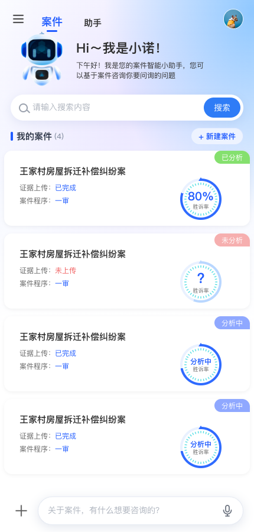
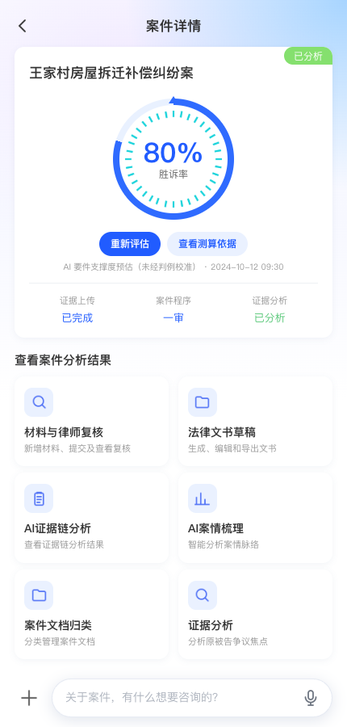
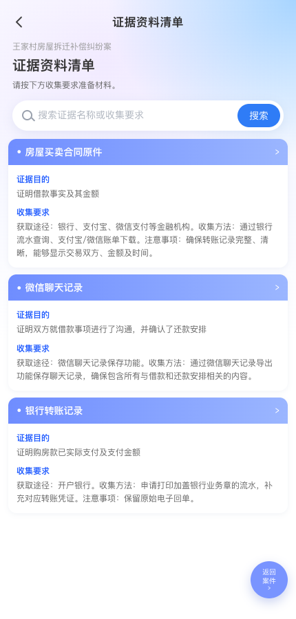
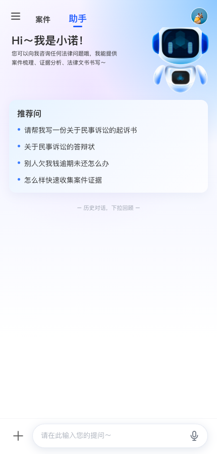
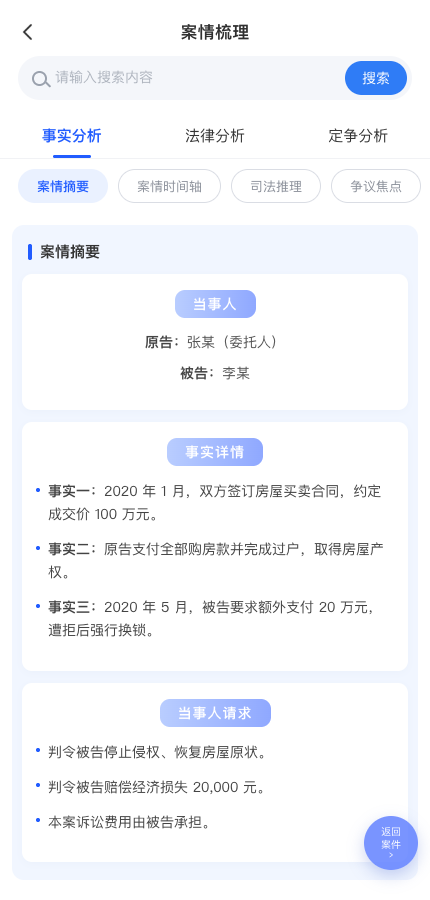
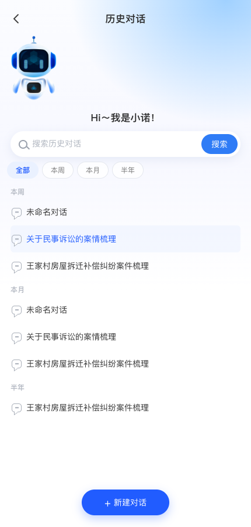

# 律法AI

[](backend/tests/)
[](#页面预览)
[](backend/.python-version)
[](backend/pyproject.toml)
[](frontend/pnpm-lock.yaml)
[](database/README.md)
[](https://github.com/xiaoqi20/legal-ai-assistant/stargazers)

律法AI 是一款面向个人、企业和法律专业用户的案件材料管理与法律咨询辅助工具。你可以在「案件」中管理证据、梳理案情并围绕当前案件提问，也可以在「助手」中向小诺发起独立的法律咨询。项目以微信小程序为首发目标，同时提供移动端 H5 预览。

[页面预览](#页面预览) · [本地体验](#本地体验) · [后端联调](#后端联调) · [产品需求](PRD.md)

## 页面预览

以下截图取自 430 像素宽的 H5 预览。案件、对话和评估数值均来自 Mock 演示数据。点击图片可查看原图。

| 案件首页 | 案件详情 | 证据资料清单 |
| :---: | :---: | :---: |
| <a href="docs/screenshots/cases.png"></a> | <a href="docs/screenshots/case-detail.png"></a> | <a href="docs/screenshots/evidence.png"></a> |
| **小诺助手** | **案情梳理** | **历史对话** |
| <a href="docs/screenshots/assistant.png"></a> | <a href="docs/screenshots/case-analysis.png"></a> | <a href="docs/screenshots/history.png"></a> |

下载仓库后，可直接用浏览器打开 [交互原型](pratice/index.html) 和 [设计稿画廊](ui-screens/index.html)。

## 核心功能

- 在**案件与证据**模块新建和搜索案件，查看证据清单，管理材料和案件文档。
- 使用**小诺问答**发起独立咨询，或在案件内结合已检索到的材料提问。接入后端后，案件问答支持流式输出与来源引用。
- 通过**案情梳理与研判**查看案情摘要、时间轴和争议焦点。后端的受控案件研判可检查证据缺口、请求补充背景并生成带引用的研判草稿。
- 接入后端后，可**管理材料和文书**，包括材料版本与复核、OCR 文字校对，以及证据目录和民事起诉状草稿的版本管理与 DOCX 导出。

## 本地体验

前端使用 Node.js `22.22.1` 和 pnpm `11.18.0`。Mock 模式可直接体验主要页面，无需启动后端或配置模型密钥。

```sh
cd frontend
pnpm install --frozen-lockfile
VITE_USE_MOCK=true pnpm dev:h5
```

浏览器打开 `http://localhost:5173`，点击「本机号码一键登录」，确认协议后选择角色，再点击「开始使用」。建议在浏览器的移动设备模式下预览页面。

### 微信开发者工具预览

在 `frontend/` 中运行以下命令，然后在微信开发者工具中导入 `frontend/dist/dev/mp-weixin/`。

```sh
VITE_USE_MOCK=true pnpm dev:mp-weixin
```

正式联调时，微信手机号授权、SSE 分块和文件传输需在目标设备上验收。

## 后端联调

后端使用 Python `3.12.14`、uv、FastAPI 和 PostgreSQL 17。API 与任务 Worker 分别运行。以下步骤用于本地开发，完整配置见 [后端运行文档](backend/README.md)。

1. 将根目录的 `.env.example` 复制为 `.env.local`，设置本地数据库密码。从仓库根目录运行 `docker compose --env-file .env.local up -d --wait`。
2. 将 `backend/.env.example` 复制为 `backend/.env`，设置 `LAW_DATABASE_URL`。按需配置模型、对象存储、OCR 和微信服务。H5 联调可在开发环境中启用 `LAW_ALLOW_DEV_LOGIN=true`。
3. 在 `backend/` 中运行 `uv sync --frozen`。新建空库运行 `uv run alembic upgrade head`。已经执行初始 SQL 的库，先按 [数据库迁移说明](database/README.md#后端增量迁移) 接管。
4. 在 `backend/` 下分别运行 `uv run uvicorn app.main:app --no-access-log` 和 `uv run python -m app.worker`。
5. 在 `frontend/` 中运行 `VITE_USE_MOCK=false pnpm dev:h5`。本地默认 API 地址为 `http://127.0.0.1:8000/api/v1`，可通过 `VITE_API_BASE_URL` 修改。API 交互文档位于 `http://127.0.0.1:8000/docs`。

## 仓库导航

| 位置 | 内容 |
| --- | --- |
| [frontend/](frontend/) | uni-app、Vue 3、TypeScript 和 Pinia，包含 H5 与微信小程序页面 |
| [backend/](backend/) | FastAPI 服务、AI 工作流、PostgreSQL 任务 Worker 与迁移 |
| [database/](database/) | 本地数据库与约束验证说明，初始结构见 [database-schema.sql](database-schema.sql) |
| [pratice/](pratice/) | 静态交互原型与功能模块清单 |
| [ui-screens/](ui-screens/) | 原始设计稿与页面画廊 |

前端验证命令为 `pnpm test`、`pnpm type-check`、`pnpm build:h5` 和 `pnpm build:mp-weixin`。后端在配置专用的 `*_test` 数据库后运行 `uv run ruff check .` 和 `uv run pytest -q`。详见 [仓库开发指南](AGENTS.md) 和 [后端运行文档](backend/README.md)。
