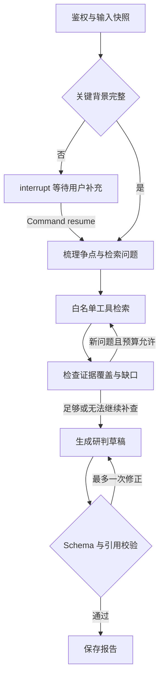

# 受控案件研判 Agent v1

2026-11-15：使用 LangGraph `1.2.22` 的自定义 `StateGraph`，新增独立的案件研判资源与 Worker 任务。沿用现有 DeepSeek / 百炼适配器、严格工具注册器、案件权限过滤与 PostgreSQL 检索。生产依赖直接声明 LangGraph，无需安装可选评测组。

## 使用与部署

升级依赖并执行 Alembic `0009`，随后重启 API 与 Worker：

```sh
cd backend
uv sync --frozen
uv run alembic upgrade head
uv run uvicorn app.main:app --no-access-log
# 另一个终端
uv run python -m app.worker
```

API 启动检查迁移版本 `0009`；已有运行记录时，降级会拒绝删除研判历史。迁移使用独立 DDL 账号，应用账号权限见 `runtime-role.sql`。本次测试只迁移专用测试数据库，业务库由部署时单独升级。

| 接口 | 行为 |
| --- | --- |
| `POST /api/v1/cases/{case_id}/assessment-runs` | 发起研判，返回 `202`、运行 `id` 与 `job_id` |
| `GET /api/v1/cases/{case_id}/assessment-runs` | 历史分页，支持 `before_id`、`limit` |
| `GET /api/v1/cases/{case_id}/assessment-runs/{id}` | 状态、问题、报告、来源快照、累计用量、费用估算与 `inputs_current` |
| `POST /api/v1/cases/{case_id}/assessment-runs/{id}/resume` | 发起人提交补充信息并入队恢复；须提供当前 `revision` |
| `POST /api/v1/cases/{case_id}/assessment-runs/{id}/cancel` | 发起人取消进行中或待补充任务 |
| `GET /api/v1/cases/{case_id}/assessment-runs/{id}/events?after_id=0` | 带 Bearer 鉴权的 SSE 进度订阅；按持久化事件 ID 续读 |

发起请求：

```json
{"question":"请分析主要争点、证据缺口及补充建议。","client_request_id":"assessment-001"}
```

`question` 可省略，默认综合研判。同一用户的 `client_request_id` 唯一；相同案件和问题重复请求返回原运行，不重复计费。相同 ID 用于不同输入返回 `409`。同一用户、同一案件仅允许一个 `pending/running/awaiting_input` 运行；他人可在有案件访问权的前提下发起自己的研判。

首次缺少诉求或我方身份信息时，进入 `awaiting_input` 并返回具体问题。使用详情返回的 `revision` 补充：

```json
{"revision":1,"answers":"我方为原告，请求对方支付剩余合同价款；对方抗辩尚未完成验收。"}
```

补充信息为本次研判的未核实用户陈述，不自动修改案件字段。重复提交旧 revision 返回 `409`。有案件访问权的成员可读结果；只有发起人可补充或取消。

进度 SSE 只包含 `progress`（`id`、`stage`）与 `done`（运行状态及待补充问题）；阶段包括 `intake/planning/retrieving/checking_coverage/drafting`。等待时发送 keepalive；断开进度订阅不会取消后台任务。恢复订阅传入上次收到的事件 ID。达到 `awaiting_input` 或终态后关闭订阅，结果通过详情接口读取。鉴权撤销后停止发送进度。

## 图流程与结果



模型提出争点和补查问题，程序控制条件边。首版在服务端读取当前案件概况、当事人与最多 50 条材料状态/证明目的；检索工具仅查询当前案件、文件可用且 `parse_status=succeeded` 的材料。复用 pgvector + pg_trgm/RRF 及可选重排，工具 JSON 参数在服务端严格校验。工具错误以脱敏结构反馈覆盖检查阶段；未知、失败或不完整材料不作为已核实事实。

检索结果按 `chunk_id` 去重，来源编号稳定；引文、文件 ID、块 ID、页码和名称作为快照保存。累计引文沿用上下文预算的一半，单工具结果和超时沿用既有工具配置。相同检索问题只执行一次；无新增材料、轮数或剩余调用预算不足时，转为生成带局限的草稿。

报告包含：

- `outcome`：`assessed` 或 `insufficient_material`；无检索来源时必须为后者。
- `summary`、`facts`：事实分别标记 `user_statement/material/inference`，材料记载必须有来源编号。
- `issues`：逐争点判断、支持/反对来源编号、证据缺口。
- `recommendations`、`legal_questions_to_verify`、`limitations`。
- 服务端附加 `review_status=unreviewed` 与“AI 辅助研判草稿 · 待专业人员复核”。

报告最多修正一次；不存在的结构化来源编号及正文 `[编号]` 都会拒绝。此校验验证来源边界与结构，不能证明每条材料在法律上支持结论，仍需专业复核。未接入权威法条/判例检索，法律适用与现行效力列为待核验；Agent 不生成胜诉概率、不审核材料、不修改案件或发布文书。

## 运行状态与控制

状态为 `pending → running → succeeded/failed/cancelled/stale`；首次背景不足时为 `running → awaiting_input → pending`。暂停后任务释放 Worker，等待时间不占有效执行预算。普通案件分析、胜诉率和问答状态保持各自语义，研判不更新案件的通用 `analysis_status`。

| 配置 | 默认值与含义 |
| --- | --- |
| `LAW_ASSESSMENT_ENABLED` | `true`，控制新运行准入 |
| `LAW_ASSESSMENT_TIMEOUT_SECONDS` | `180`，有效执行总时限，暂停时保存剩余秒数 |
| `LAW_ASSESSMENT_MAX_MODEL_CALLS` | `8`，累计模型请求上限，包括无效输出与修正 |
| `LAW_ASSESSMENT_MAX_TOOL_CALLS` | `8`，累计工具调用上限，恢复不会重置 |
| `LAW_ASSESSMENT_MAX_SEARCH_ROUNDS` | `3`，检索轮数上限 |

总并发和限流沿用现有配置；工具错误数、单工具超时与结果大小沿用 `LAW_AGENT_MAX_TOOL_ERRORS`、`LAW_TOOL_*`，上下文与输出沿用 `LAW_MAX_CONTEXT_CHARS` / `LAW_MAX_OUTPUT_CHARS`。图另设 `recursion_limit=32` 防止异常循环。硬预算超限进入失败终态；证据不足可以完成一份明确标注不足的报告。

失败码包括 `assessment_model_limit`、`assessment_tool_limit`、`assessment_tool_error_limit`、`assessment_context_limit`、`assessment_output_limit`、`assessment_output_incomplete`、`assessment_timeout`、`assessment_upstream_error`、`invalid_assessment_plan`、`invalid_assessment_coverage`、`invalid_assessment_report`、`model_outcome_unknown`、`assessment_version_changed`。异常原文不进入公开错误或日志。

## 持久化、快照与恢复

`case_assessment_runs` 保存业务状态、输入指纹、来源、报告和预算；`case_assessment_steps` 保存调用台账与进度；`case_assessment_checkpoints/writes` 保存 LangGraph 原生检查点及 pending writes。检查点使用同步持久化 `durability=sync`。

为使检查点写入与现有租约在同一事务校验，首版实现 `BaseCheckpointSaver` 的 PostgreSQL 适配器，复用 SQLAlchemy 连接池。检查点、节点结果、来源和报告写入均锁定并检查 job 的 `lease_token`、有效租期及运行状态；旧 Worker 不能覆盖新执行。模型无法提供或修改内部 `thread_id`、用户/案件 ID。检查点原始数据和模型选择过程不通过 API 暴露。

快照指纹覆盖案件字段、当事人、材料版本与状态、附件关联、文件哈希/解析状态、分块内容摘要和 OCR 校对内容/状态。每个外部调用前后以及最终保存前校验；恢复前资料变化返回 `409 stale_inputs`，运行中变化进入 `stale`。已完成报告仍保留历史来源；详情的 `inputs_current=false` 表示当前资料已变化，需重新发起。

Worker 租约失效后可以重新领取，使用原运行检查点继续，预算不清零。恢复时分别处理初次输入、`interrupt` 补充和错误后的 `ainvoke(None)`。已完成模型步骤复用台账结果，避免检查点边界崩溃造成重复生成；已预约但未保存结果的模型调用进入 `model_outcome_unknown`，不自动再请求付费模型。只读工具可以复用原预约重试。这个保守策略不声称上游请求具备 exactly-once 语义。

所有模型步骤的 usage 保存于台账，详情返回累计 token 和可配置价格估算；任一已预约步骤没有完整 usage 时，总用量与费用均为 `null`。不保存或展示 `reasoning_content`。内部检查点和调用结果包含敏感案件上下文，沿用业务库访问、备份与保留策略，不发送外部追踪服务。

## 验证与范围

`tests/test_assessment.py` 使用合成案件、真实专用 PostgreSQL 和替身模型，覆盖完整流程、来源/用量、暂停/恢复、重复请求、旧版本提交、取消、权限撤销、过期输入、检查点读写/历史、租约隔离、进程中断恢复、输出修正和不确定模型结果。

首版交付后端 API、Worker 与进度协议；已有问答界面继续使用原流程。真实 DeepSeek 工具/JSON 能力、研判质量与目标设备展示仍需后续联调及专业样本评估。

参考：[LangGraph 图 API](https://docs.langchain.com/oss/python/langgraph/graph-api)、[检查点](https://docs.langchain.com/oss/python/langgraph/checkpointers)、[中断恢复](https://docs.langchain.com/oss/python/langgraph/interrupts)。
