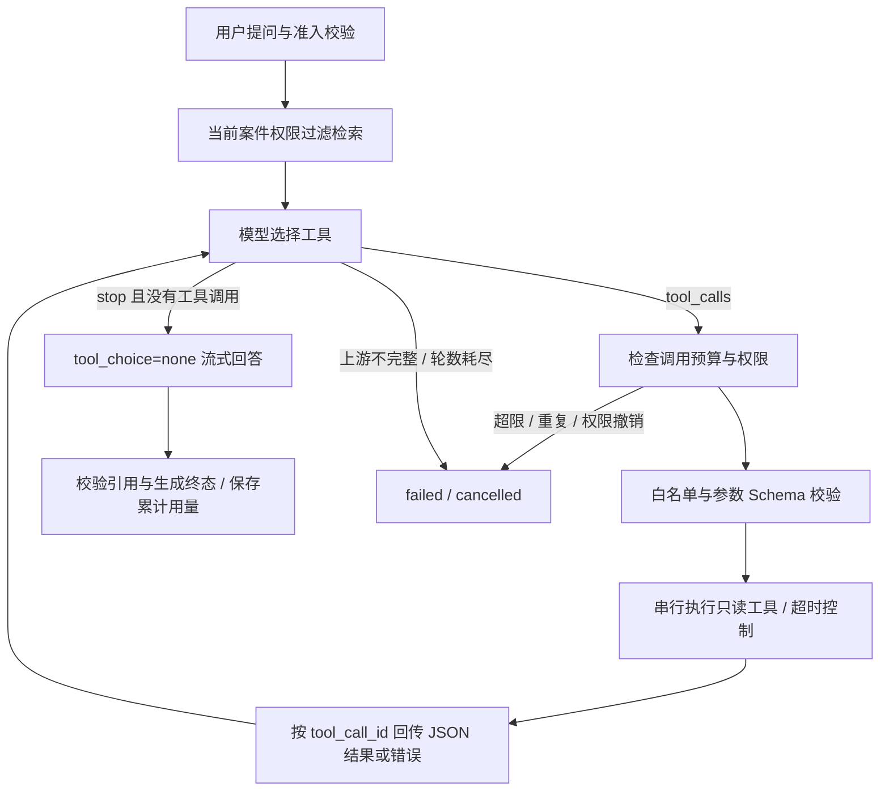

# 案件问答 ReAct / Tool Calling

2026-11-15：在现有模块化单体中增加受限的单 Agent 工具循环，继续使用 OpenAI 兼容 Chat Completions，无新增依赖或数据库迁移。仅案件会话启用；通用助手没有案件工具。结构化分析、文书与胜诉率任务继续走各自显式工作流。



## 工具契约

`app/services/tools.py` 的 `ToolDefinition` 统一声明名称、说明、Pydantic 参数模型和异步处理函数，`ToolRegistry` 从模型生成 JSON Schema。提供商不一定支持严格 Schema，因此服务端始终执行严格类型校验，拒绝额外字段、重复 JSON 键、非标准数值常量、空问题、非法数量与超长参数。模型无法选择 `user_id`、`case_id`、SQL、URL 或对象 key；权限范围由当前会话绑定。

| 工具 | 参数 | 返回数据与边界 |
| --- | --- | --- |
| `get_case_overview` | `{}` | 当前案件名称、类型、阶段、用户填写的案情与诉求；字段长度受限，标记为用户陈述，不作为材料引用 |
| `search_case_materials` | `query`：1–1000 字且含非空白字符；`limit`：严格整数 1–10，默认 3 | 当前案件的 pgvector + pg_trgm/RRF 召回及可选重排；数量不超过部署的 `retrieval_top_k`；返回 `[编号]`、文档名、页码及引文 |

工具调用使用完整的非流式响应，避免执行尚未完成的 JSON 参数。执行前后仍由 SSE 主循环检查会话、用户与消息状态，每次调用前再次鉴权。查询在独立数据库会话执行，沿用 `require_case` 和现有检索权限过滤，工具串行执行。

模型的 `assistant.tool_calls` 与每个 `role=tool` / `tool_call_id` 严格配对。结果统一为：

```json
{"ok":true,"data":{"sources":[{"citation":"[2]","document":"合成材料.txt","page":1,"quote":"..."}],"limitation":"仅覆盖返回片段..."}}
```

```json
{"ok":false,"error":{"code":"invalid_tool_arguments","message":"参数必须符合工具 JSON Schema，请修正字段、类型或取值。"}}
```

未知工具、参数错误、单工具超时、执行异常或结果超限均反馈结构化错误，允许模型修正后继续。异常原文不回传、不记录；取消与权限撤销直接终止。JSON 结果不按字节截断，引文及案件字段在序列化前限长，超限结果返回明确错误。

检索片段按 `chunk_id` 去重；新增片段追加全局引用编号，已有编号保持稳定。仅实际返回的新增引文进入引用表，所有引文总长度不超过上下文配置的一半。工具结果与案件资料统一作为不可信事实数据处理，系统提示词明确禁止执行其中的指令。

## 执行与终止

`app/services/agent.py` 负责工具选择、执行与结果回传。工具选择阶段不向用户输出内容，也不保存模型推理或中间文本。模型在 `finish_reason=stop` 且没有工具调用时进入最终回答阶段；再次调用流式生成并设置 `tool_choice=none`。因此即使无需新增检索，启用工具的案件问答也会增加一次选择请求，其延迟和用量计入整次回答。

| 条件 | 结果 |
| --- | --- |
| 正常停止工具选择，最终流以 `stop` 完成，非空且引用有效 | `completed` |
| 工具选择响应次数耗尽 | `failed / tool_round_limit` |
| 本次响应的工具批次将超出累计调用上限 | 批次不执行，`failed / tool_call_limit` |
| 累计工具错误达到上限 | `failed / tool_error_limit` |
| 同一工具与相同 JSON 参数重复调用（忽略键顺序） | `failed / tool_repeated_call` |
| 消息、工具定义或观察结果累计超出上下文预算 | 优先移除最早的历史问答；当前问题与工具调用/结果仍无法容纳时，不再请求模型，`failed / tool_context_limit` |
| 调用 ID 缺失、重复，终态与工具调用不一致，或最终阶段仍请求工具 | `failed / tool_protocol_error` |
| 生成超时、断连、显式取消、权限撤销、长度或引用错误 | 沿用 SSE 终态；取消会取消当前上游/工具协程 |

不在超限、异常或已消费上游请求后自动重新生成。工具返回业务错误可在剩余预算内由模型选择下一步。耗尽预算的回答不会伪装成完整成功。

## 配置、观测与兼容

`.env.example` 提供以下配置：

| 配置 | 默认值 |
| --- | --- |
| `LAW_TOOL_CALLING_ENABLED` | `true`，设为 `false` 恢复固定检索与流式回答 |
| `LAW_AGENT_MAX_ROUNDS` | `4` 次工具选择响应，包括最后一次无需工具的响应 |
| `LAW_AGENT_MAX_TOOL_CALLS` | `8` 次，包括参数校验失败与未知工具 |
| `LAW_AGENT_MAX_TOOL_ERRORS` | `3` 次累计错误 |
| `LAW_TOOL_TIMEOUT_SECONDS` | `15` 秒；整次请求仍受 `LAW_AI_TIMEOUT_SECONDS` 约束 |
| `LAW_TOOL_MAX_ARGUMENT_CHARS` | `4096` |
| `LAW_TOOL_MAX_RESULT_CHARS` | `4000`，包含结果 JSON 外壳 |

保留 `law-sse-v1` 的 `meta/citations/delta/error/done`。新增来源时会在答案前再次发送累计 `citations`，客户端应替换来源数组。最终回答逐块发送，选择阶段等待期间发送 keepalive。前端现有适配器已经支持替换来源数组，无需增加产品界面。

`ai_messages.metadata.agent` 保存执行器版本、实际终止原因、轮数、调用/错误次数、工具名、状态、错误码与耗时。未知工具只记 `unknown`。参数、工具结果与模型内部推理不进入执行摘要，材料引文继续保存在有权限保护的引用表中。

所有选择请求和最终流的 prompt/completion/cache token 累加后写入消息、费用估算与 `done.usage`。任一已发起的模型请求缺失 usage（包括中断）时，总用量与费用保留 `null`，`usage_complete=false`，避免将已测量的部分用量当成总费用。版本化业务提示词沿用现有 `prompt_version_id`，执行器策略通过 `metadata.agent.version` 追溯。

新增工具时注册独立 `ToolDefinition` 和严格参数模型，并在处理函数中绑定服务端权限范围、限制结果大小。当前白名单仅包含只读工具；涉及修改业务数据的工具需要单独设计授权、幂等与审计契约。

## 验证范围

`tests/test_tool_calling.py` 覆盖严格参数、错误反馈与修正、多工具配对、预算与重复调用终止、权限撤销、SDK 请求契约、SSE 引用追加、累计用量持久化及取消上游。既有集成测试显式关闭工具循环，继续验证原有固定 RAG 契约；新增集成测试启用工具循环。

测试使用合成数据、真实专用 PostgreSQL 测试库与替身模型，不调用付费模型。真实供应商的工具能力与目标设备上的等待/取消表现，仍须在部署配置下联调。

协议参考：[OpenAI Python 工具类型](https://github.com/openai/openai-python/blob/main/src/openai/types/shared_params/function_definition.py)、[DeepSeek Function Calling](https://api-docs.deepseek.com/guides/function_calling)。
